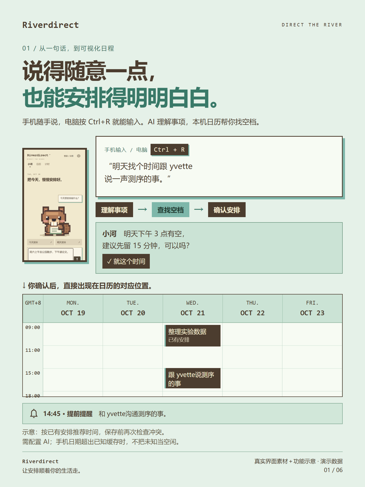
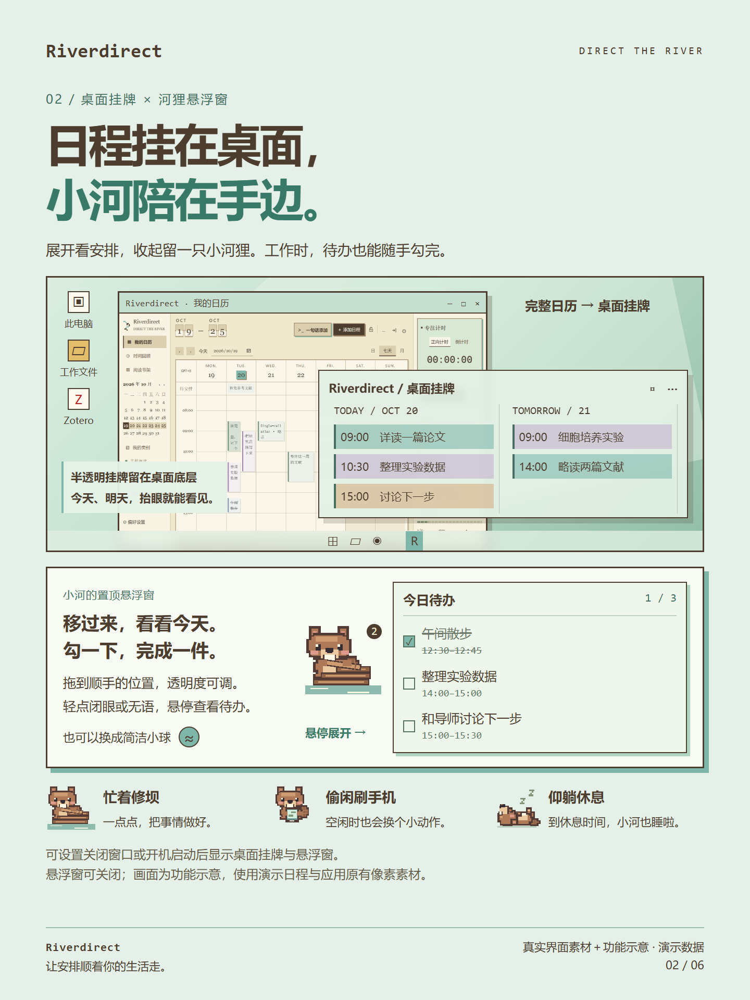
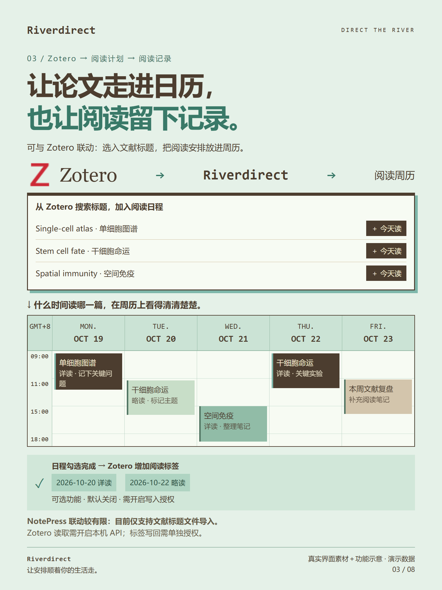
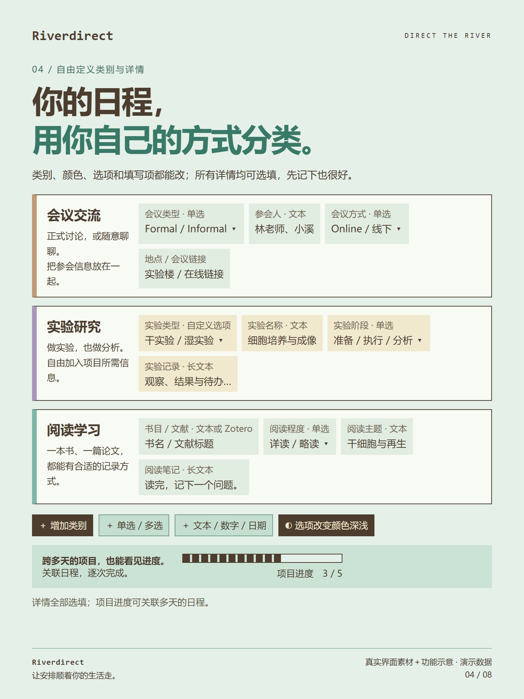
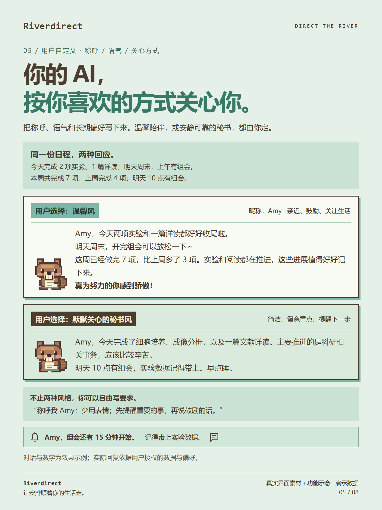
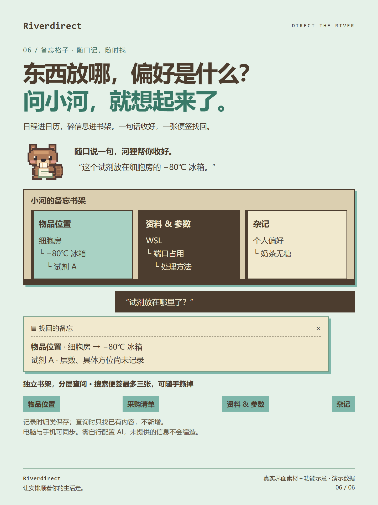
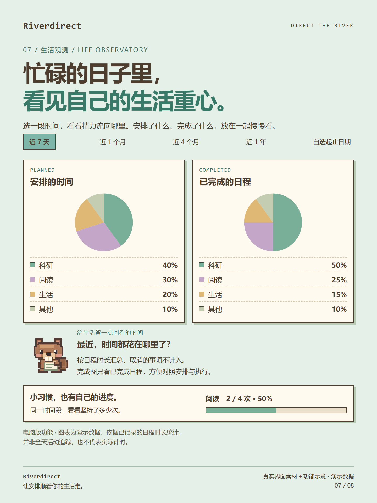
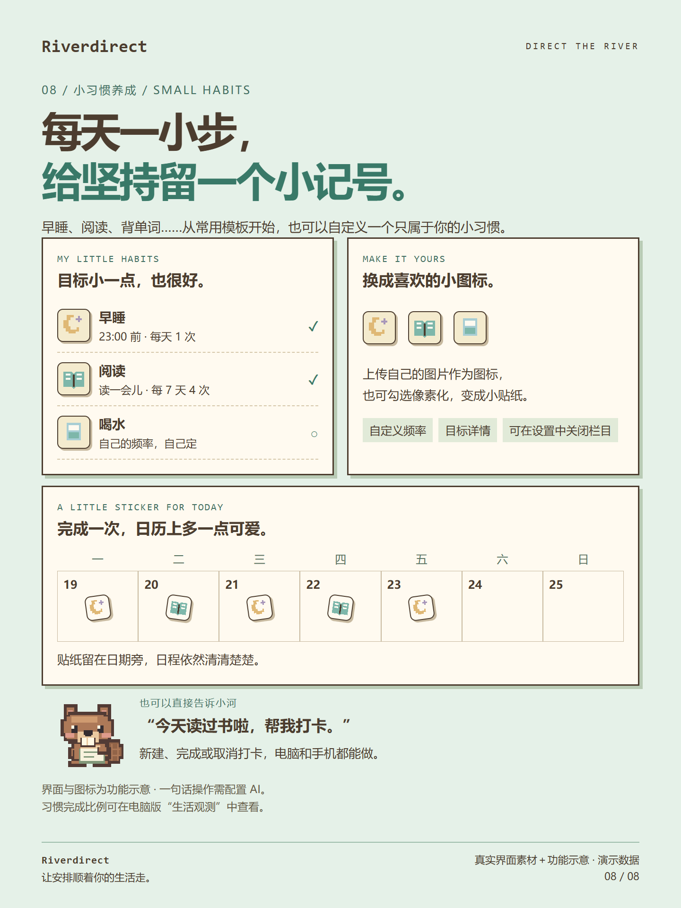

# Riverdirect

**DIRECT THE RIVER · 让安排顺着你的生活走。**

像素风日程与备忘工具，配有小河狸助手。在手机上输入一句话，或在电脑按 **Ctrl+R** 打开输入框。配置好你选择的 AI 后，小河会帮你整理事项、补充类别和详情，再放进日历；时间没定好，就先推荐空档，等你确认。零碎信息可以收进备忘书架，需要时再问它。

**[下载 Windows / Android](https://github.com/Ariel98-xie/Riverdirect-App/releases/latest)** · [使用说明](使用说明.md) · [隐私与试用说明](隐私与试用说明.md) · [反馈问题](https://github.com/Ariel98-xie/Riverdirect-App/issues)

欢迎 **Star 收藏**、下载试用，也欢迎告诉我哪些操作还不够顺手。当前为早期试用版，免费试用，源码暂不公开。

## 从一句话，到看得见的安排

“明天找个时间跟 yvette 说一声测序的事。”

小河理解事项，结合已知日程推荐空档；你确认后，安排出现在日历对应位置。参会人、阅读程度等信息可以填在对应类别的字段里，也可以继续对话，修改刚才的安排。这些语义理解功能需要配置 AI，保存后请核对日期、类别和详情。

## 日程留在桌面，随时看一眼

电脑主窗口可切换为半透明桌面挂牌，查看今日与明日。

想让小河陪在手边，可以开启置顶的像素河狸悬浮窗：鼠标移过去看今日待办，勾一下就完成；拖到顺手的位置，或换成简洁小球。小河会修坝、玩手机，到休息时间仰躺睡觉。轻点一下，它还会闭眼或露出无语表情。

可设置关闭窗口后自动挂到桌面，以及开机启动后显示底层挂牌和置顶悬浮球。日历支持日、五天／七天和月视图，配有专注计时。

## 给阅读安排一个位置

**可与 Zotero 联动**：搜索本机文献标题，选入日程，安排详读或略读。完成后可选写回阅读标签，默认关闭，需另行授权。NotePress 联动较有限，目前仅支持文献标题文件导入。连接步骤与常见问题见[使用说明](使用说明.md#zotero-联动电脑版)。

## 类别由你定义，小河按你的方式陪伴

会议可以有参会人和会议方式，实验可以有实验类型与进度，阅读可以有书目和阅读程度。类别颜色、选择项、填写项都能自己设置。电脑端还能规划长期任务，再把步骤安排进日历。

电脑端修改使用中类别的颜色，已有日程会一起更新颜色，原有详情保留；归档日程保留历史颜色。选择类别或专注计时关联日程时，列表显示颜色小方块，便于查找。日历只在日程实际重叠的区间分栏。

日视图可展示日程详情；日、周、月视图均可导出为 3:4 竖版 PNG，适合保存或分享。内容较多时会自动续页。

小河的称呼、语气和长期偏好也由你决定。想回顾时，点击“小河想对你说”，生成总结；喜欢的内容可保存到时间手记。

看看自定义类别与小河对话示意

## 碎信息收进书架，想找时问一句

“试剂 A 放在实验室 409 的四度冰箱第三层。”——按位置分层收好。

“试剂放在哪里了？”——查找已有备忘，不新增一条。资料可以按“生信相关 → 单细胞转录组分析 → 参数选择注意事项”整理，灵感也能分成文学、摄影、科研。内置常用目录模板，允许添加和改名；查询结果可贴成便签，最多保留三张。

## 看看最近的生活重心

电脑版从侧栏进入独立的“生活观测”页面，采用纯色像素图表，提供近 7 天、1 个月、4 个月、1 年和自选日期范围。两张扇形图分别展示安排时间与已完成日程的类别占比，按记录的日程时长汇总，不计取消事项。它帮助回看安排与执行，并非全天活动追踪或实际用时测量。

页面内有「生活概览」与「时间回顾」两个子页；时间回顾里可看今日统计、生成小河回顾或打开时间手记。同一时间段还能查看小习惯完成比例，例如计划阅读 4 次、完成 2 次，就是 50%。

## 每天一小步，给坚持留个记号

新建入口在日历右栏「小习惯养成 → ＋ 新建」，生活观测顶部也有「＋ 新建小习惯」。从早睡、阅读、背单词等常用模板开始，也可以自定义目标和完成频率。上传喜欢的图片作为图标，或勾选像素化；完成后，小贴纸出现在日历里。暂时不需要时，可在设置中关闭栏目，记录会保留。

电脑和手机都可以新建习惯、完成或取消打卡；配置 AI 后，也可以直接告诉小河：“今天读过书啦，帮我打卡。”生活观测提供在电脑上回看的入口。

## 下载与开始

| 设备 | 当前版本 | 使用方式 |
|---|---|---|
| Windows 10 / 11，64 位 | 0.1.32 | 下载 EXE，放入固定文件夹后双击，无需安装 Python |
| Android | 0.1.32 | 下载 APK 安装，主要用于查看、询问、上传与提醒 |

安卓包不是鸿蒙 6 原生应用。Windows EXE 约 90 MiB；APK 约 0.8 MB。两端当前版本统一为 0.1.32。

1. 可以先不登录，手动添加日程、体验日历和计时。
2. 需要 AI 时，在设置中填写服务商接口地址、模型和 API Key；每台设备单独填写 Key。
3. 需要同步时，两端用同一邮箱账号登录。普通试用者无需自建云端或执行 SQL。

## 使用前了解这些

- **电脑和手机同步**：电脑保存完整历史，手机可选 5／7／30 天缓存。云端只临时传递修改，最多保留 72 小时，每账号待同步内容最多 1MB，接收后会删除。**内置同步不提供云端备份，请自行导出，或在电脑配置自有网盘备份。** 离线设备恢复、重试和提醒的处理方式，见[使用说明](使用说明.md#新版临时同步与提醒)。
- **电脑自有云备份**：可以连接自己的 HTTPS WebDAV 网盘，数据用独立备份密码加密后上传。支持手动备份、每日自动备份、查看历史和恢复。此功能仅在电脑提供，不用于多端同步，也不占平台中转空间。请另存备份密码，忘记后无法恢复。
- **AI 由你选择**：接口与模型设置可同步，API Key 不同步。使用 AI 时，输入及你允许参考的相关上下文会发往所选服务商，费用和数据处理规则由该服务商决定。
- **提醒有设备条件**：手机已缓存日程可使用本地通知，需要通知权限，效果受系统省电及后台限制影响。目前未接入远程云推送，不承诺电脑离线时立即收到其他设备新增的提醒。
- **Zotero 需设置**：标题搜索需要打开 Zotero 并启用本机 API；可选标签写回另需官方云端个人库读写授权与 Zotero 同步。完成这些设置后，才能使用对应的联动功能。
- **早期版本**：图中使用演示数据，包含流程示意；AI 示例不代表真实模型输出，也不代表所有手机上都已完成真机验证。使用前请备份重要安排，遇到问题欢迎反馈。

内置同步使用 HTTPS 传输，但没有端到端加密；项目管理员能够读取仍在云端中转的正文。

本仓库仅提供产品介绍、使用说明、宣传图与安装包下载，不包含源码、需求文档或测试脚本。Zotero 标识归其权利人所有，使用该标识不代表官方合作。

GitHub 在 Release 页面自动显示的 “Source code (zip)” 和 “Source code (tar.gz)” 是公开资料归档，名称由 GitHub 固定；其中不包含应用源码、SQL、测试脚本或个人数据。

## 当前版本 0.1.32

时间回顾并入生活观测子页；修复长期任务切页后仍占位的问题，统一长期任务字体，并在日历右栏和生活观测顶部增加新建小习惯入口。生活观测保留光滑圆盘、纯色扇区及像素风方角卡片。

建议两端一起更新：电脑退出程序后替换 EXE，保留旁边的 data；安卓覆盖安装，不要先卸载。具体操作与功能限制见[使用说明](使用说明.md)。

Releases 仅保留当前版本的 Windows EXE、Android APK 和 SHA256SUMS.txt，不重复提供安装包 ZIP。
